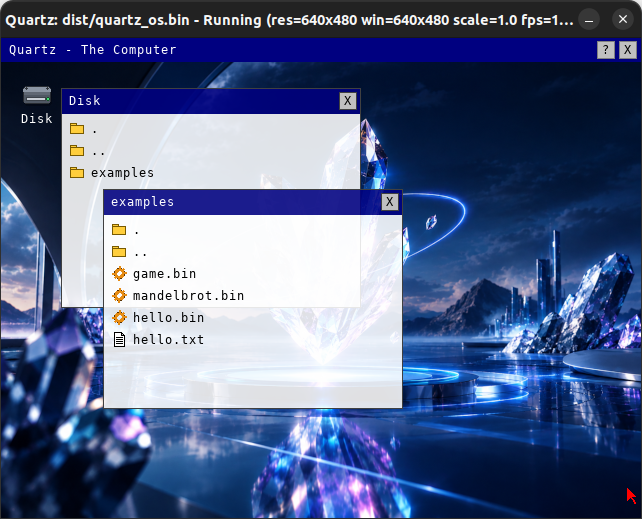

# Quartz - The Computer

Quartz is a small register-based virtual machine with a built-in graphical
and text-mode display, keyboard/mouse input, and sound — a "fantasy
console" in the spirit of CHIP-8, PICO-8, or Uxn. It runs a custom binary
program format directly, with no operating system in between: the VM
interpreter, the framebuffer, and the window/rendering loop all live in a
single process and a single thread.




## How it works

### Single process, single thread

Quartz has no client/server split and no sockets. The VM interpreter and
the [raylib](https://www.raylib.com/) render loop run in the same
`while (!WindowShouldClose())` loop:

```
while the window is open and the VM hasn't halted:
    run up to N VM instructions (stop early if the program calls VSYNC)
    upload the framebuffer to the GPU (only if it changed this frame)
    draw the frame
```

A program yields control back to the render loop by executing `vsync`.
There is no explicit sleep or busy-wait involved in this hand-off — the
frame's timing is entirely governed by raylib's `SetTargetFPS()`, which
uses a real OS sleep internally. This is also why the window closes
automatically the moment the VM halts (`halt` instruction, or a runtime
fault), and conversely why closing the window stops the VM.

### RAM, registers, stacks

- **RAM**: a flat byte array (`--ram <bytes>`, default 32768), addressed
  with 32-bit addresses. All memory access instructions bounds-check
  against RAM size and fault (halting the VM) on an out-of-range access.
- **16 general-purpose registers** (`R0`–`R15`), each a 64-bit integer.
  Most instructions carry an explicit **type tag** (see below) describing
  how to interpret/truncate a register's value for that operation —
  registers themselves are untyped 64-bit storage.
- **Call stack** (up to 8192 return addresses) for `call`/`ret`.
- **Data stack** (up to 65535 values) for `push`/`pop`.

### Value types

Many instructions take a one-byte type tag that controls the width and
signedness/float-ness used to interpret a register or immediate value:

| Type tag | Meaning | Size |
|---|---|---|
| `I8`  | signed 8-bit   | 1 byte |
| `I16` | signed 16-bit  | 2 bytes |
| `I32` | signed 32-bit  | 4 bytes |
| `I64` | signed 64-bit  | 8 bytes |
| `U8`  | unsigned 8-bit  | 1 byte |
| `U16` | unsigned 16-bit | 2 bytes |
| `U32` | unsigned 32-bit | 4 bytes |
| `U64` | unsigned 64-bit | 8 bytes |
| `F32` | 32-bit float (IEEE 754) | 4 bytes |
| `F64` | 64-bit float (IEEE 754) | 8 bytes |

Immediate values (`IMM` in the instruction table) are encoded as 4 bytes
for every type except `I64`/`U64`/`F64`, which use 8 bytes.

## Running Quartz

```
quartz <image.bin> [options]

Options:
    --ram <bytes>           RAM size (default: 32768)
    --videomode <1|2|3>     Video mode (default: 1)
    --scale <1.0-6.0>       Window scale (default: 1.0)
    --fps <60|120|240>      Target FPS (default: 120)
    --cursor <0|1>          Show/hide the OS mouse cursor (default: 1)
    --dump <filename>       On exit, write the final contents of VM RAM
                             to <filename> (handy for debugging)
    --disk <path>           Attach an already-formatted SVFS virtual disk
                             image. Not required — if omitted, no disk is
                             attached and the OP_SVFS_* instructions simply
                             do nothing. The image is NOT formatted by the
                             VM itself (create it with the `svfs` CLI
                             tool's `format` command first).
    --help                  Show help and exit
```

### Keyboard shortcuts

| Shortcut | Action |
|---|---|
| `Ctrl+Alt+PgUp` / `PgDn` / mouse wheel | Zoom in / out |
| `Ctrl+Alt+P` | Pause / unpause (both the VM and the display freeze) |
| `Ctrl+Alt+R` | Reboot (reset registers/RAM/PC, reload the data segment, clear the display) |
| `Ctrl+Alt+S` | Cycle target FPS: 60 → 120 → 240 |


### Graphics and text output

Quartz has two independent display layers, drawn on top of each other:

- **Pixel framebuffer** — an RGBA8888 bitmap at the video mode's
  resolution. `gfx_*` instructions write into it (either through an
  explicit RAM buffer via `gfx_frame`/`gfx_raw`, or one pixel at a time
  via `gfx_pix`).
- **Text grid** — a character/foreground/background cell grid (like a
  terminal), drawn *underneath* the pixel layer. `txt_*` instructions
  write into it.

Video mode (chosen with `--videomode`) fixes both the pixel resolution
and the text grid size:

| Mode | Resolution | Text grid |
|---|---|---|
| 1 (default) | 640×480   | 80×30 |
| 2 | 1024×768  | 128×48 |
| 3 | 1280×960  | 160×60 |

### Input

`in_mouse`/`in_key`/`in_poll` read the current mouse position/buttons and
up to 4 currently-held keyboard keys directly (no events/queue — this is
a polling model, call it once per frame).

## Binary image format (`.bin`)

A Quartz program image is a fixed 22-byte header, followed by a code
segment, followed by an optional data segment:

```
[HEADER: 22 bytes] [CODE SEGMENT: code_len bytes] [DATA SEGMENT: data_len bytes]
```

| Offset | Size | Field | Description |
|---|---|---|---|
| 0  | 4 | magic        | Fixed bytes `00 51 4D 47` |
| 4  | 1 | img_version   | Must equal the VM's `IMG_VERSION` (currently `4`) |
| 5  | 1 | emu_version   | Must equal the VM's `EMU_VERSION` (currently `255`) |
| 6  | 4 | entry         | Initial program counter (u32, little-endian) |
| 10 | 4 | code_len      | Length of the code segment in bytes (u32, LE) |
| 14 | 4 | data_len      | Length of the data segment in bytes (u32, LE); `0` = no data segment |
| 18 | 4 | data_addr     | RAM address the data segment is copied to (u32, LE) |

### The data segment

If `data_len > 0`, the VM copies those bytes verbatim into RAM starting at
`data_addr` — every time the VM (re)starts, including after a
`Ctrl+Alt+R` reboot. This gives a program pre-loaded, ready-to-use data in
RAM the moment it starts running (lookup tables, sprite data, strings,
whatever you like), with no code needed to write it in manually.

The VM validates the data segment on load:
- if `data_addr + data_len` doesn't fit inside RAM (`--ram`), loading
  fails with an error and the VM does not start;
- if the file doesn't actually contain `data_len` bytes after the code
  segment, loading fails with a truncation error;
- if `data_len == 0`, the VM prints `No data segment found.` and simply
  starts with zeroed RAM.

On success, the VM prints `Loaded <N> bytes to RAM (data segment @
0x<addr>)`.


### Build
```
mkdir build
cd build
cmake ..
make
```