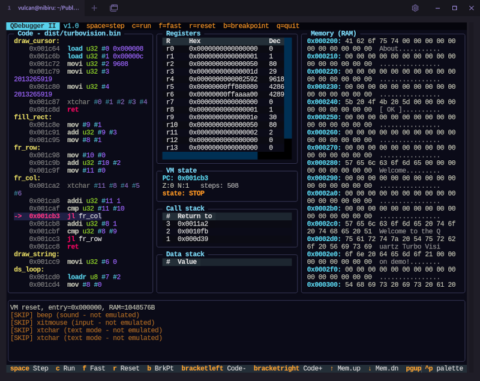

# QDebugger II

A textual (TUI) debugger for compiled QuartzVM binaries (`.bin`)

## Installation

```
pip install -r requirements.txt --break-system-packages
```



## Running

```
python3 qdebug2.py program.bin
```

If a `program.map` file (generated by `qasm.py ... --map`) exists next to
`program.bin`, the debugger loads it automatically and shows your labels
instead of raw addresses in both the code view and the call stack. You can
also specify it manually:

```
python3 qdebug2.py program.bin --map program.map --ram 2097152
```

## Controls

| Key            | Action                                                          |
|----------------|-----------------------------------------------------------------|
| `space` / `s`  | step one instruction                                             |
| `c`            | animated run (~25 instr/s), also stops on a breakpoint/halt      |
| `f`            | fast run until halt/breakpoint/fault (no animation)              |
| `r`            | reset the VM to the start (reloads the data segment, zeroes RAM) |
| `b`            | toggle a breakpoint on the current (PC) instruction              |
| `[` / `]`      | manually scroll the code panel; the next step re-centers on PC   |
| `up` / `down`  | move the memory window by 1 row (16 bytes)                       |
| `pageup/pagedown` | move the memory window by a full page                         |
| `home`         | jump the memory window to address 0x0                            |
| `:`            | enter a hex address for the memory panel to jump to (Enter/Esc)  |
| `q`            | quit                                                             |

## What is actually emulated

The emulator (`qd2/emulator.py`) faithfully mirrors `src/vm.c` for everything
related to program flow, registers, stacks, and memory:

- control flow: `jmp*`, `call*`, `ret`, conditions (`cmp`, `cmpi`, Z/N flags)
- the data stack (`push`/`pop`) and the call stack (`call`/`ret`)
- memory: `load`/`store`/`loadr`/`storer`/`memcpy`/`memset` (with RAM bounds checking)
- the full arithmetic and type system (i8..u64, f32/f64, correct overflow/truncation)
- `print` (writes to the log exactly as on the real VM)

Instructions related to surrounding hardware — sound (`beep`/`sound`),
graphics (`xframe`, `xpix`, ...), text mode (`xt*`), input (`xi*`/`xit*`), and
the virtual disk (`fs*`/SVFS) — **are not emulated**. The debugger simply
"skips" them (consumes the operands and, where relevant, zeroes the output
registers to a safe value) and writes `[SKIP] ...` to the log, so it's clear
that nothing real happened there. This is intentional — this is a debugger
for program flow/stack/memory, not a display emulator.

`vmx` (dynamically loading new code from RAM) is also not supported — it
falls outside the scope of the statically disassembled code segment that the
debugger displays; the instruction is simply skipped with a note in the log.
